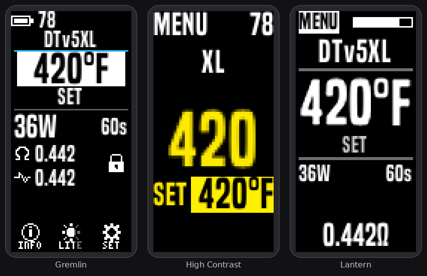
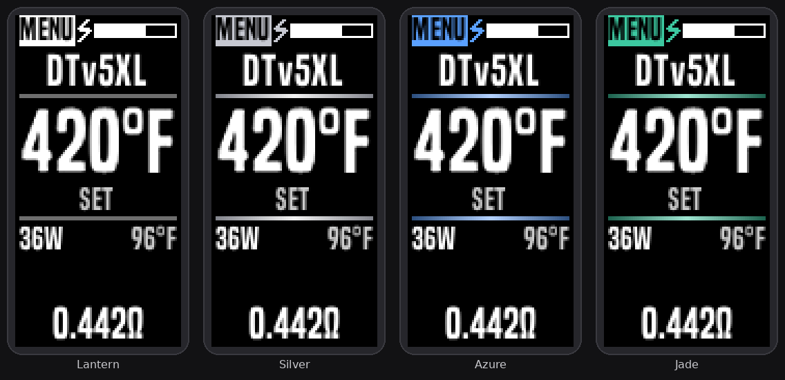
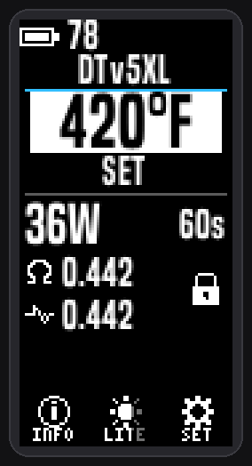
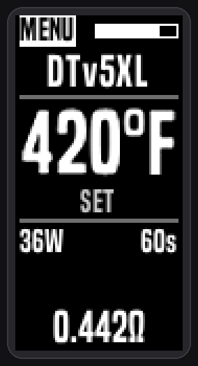
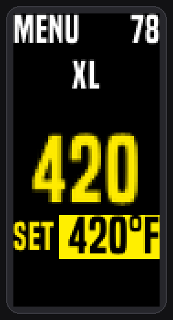

# Gremlin — custom themes for Evolv DNA color mods

*Preview renders made from the theme files, not photos. Your mod's screen may look
slightly different.*

Free screen themes for vape mods with an **Evolv DNA color chip**, tested on the DNA 100C
([which chips](#which-chips)).
A theme changes what your mod's screen looks like and how you move around it. It does
not change how the mod fires. You install a theme with Evolv's free **EScribe** software
in about five minutes, and you can switch back whenever you like.

> **Use at your own risk.** Everything here is provided as is, with no warranty, and is not
> affiliated with Evolv. Read the [disclaimer](DISCLAIMER.md) before you install or fire anything.

## Pick a theme

| Preview | Theme | What it is like | Download |
|---|---|---|---|
|  | **Gremlin** v2.9 | Function over form. Everything on one screen: temperature, watts, session time, resistance, battery, and a chart of your last puff. White text, with color only as markers. | [gremlin_current_theme.ecigtheme](files/gremlin_current_theme.ecigtheme) |
|  | **Lantern** v1.6 | Form slightly over function. A calm screen: one big number, what is wrong (if anything), and what is happening during a puff. Comes in four accent colors. | [Lantern](files/lantern_v1.6_theme.ecigtheme) · [Silver](files/lantern-silver_v1.3_theme.ecigtheme) · [Azure](files/lantern-azure_v1.0_theme.ecigtheme) · [Jade](files/lantern-jade_v1.0_theme.ecigtheme) |
|  | **High Contrast: Large Text** v1.3 | Simple. Very large yellow and white digits on black, and only what you need on each screen. Made for people who have trouble reading a mod screen. | [gremlin_high_contrast_v1.3_theme.ecigtheme](files/gremlin_high_contrast_v1.3_theme.ecigtheme) |

*Previews are renders, not photos. Each theme's guide has a gallery of every screen.*

Want every number on screen? Take **Gremlin**. Want a calm, simple screen? Take
**Lantern**. Is small text hard to read? Take **High Contrast**.

## Which chips

| Theme | DNA 100C | DNA 250C | DNA 75C | DNA 60C, DNA 80C, mono or LED-only |
|---|---|---|---|---|
| Gremlin, Lantern | Tested | Expected, not yet tested | Expected, not yet tested | Will not work |
| High Contrast | Tested | Expected, not yet tested | Does not fit | Will not work |

- **Tested on** a DNA 100C with Evolv's international firmware SP55.1. The 250C and 75C
  have the same 160×80 color screen and buttons, and EScribe builds the theme for both.
- **Expected, not yet tested** means not yet tested on hardware.
- **The DNA 100C is no longer in production.** Evolv points to the DNA 75C and DNA 250C
  as its alternatives (the 250C needs more than one battery).
- **International (INT) firmware** is needed for Session Mode.
- If the upload says **No Compatible Firmware**, your chip or firmware lacks a feature the
  theme uses. Nothing is written to the mod in that case.
- **Will not work:** DNA 60C (smaller 160×40 screen, two buttons), DNA 80C (no theme
  designer), and mono or LED-only DNA chips.
- **High Contrast does not fit on the DNA 75C:** EScribe reports it out of space.

## Install in 5 steps

You need a computer (Windows or Mac) with EScribe and a USB cable.

1. **Download** the theme file from the table above. On the file's page, click
   **Download raw file**.
2. **Connect** your mod to the computer by USB and open **EScribe**. Wait until it says
   your device is connected.
3. **Back up** what you have now: **File → Save**.
4. Click the **Theme** tab, click **Load Theme...**, and choose the file you downloaded.
5. Click **Upload Settings to Device**. Your mod's screen changes to the new theme.

If the mod shows **LOCKED** afterward, click the fire button five times quickly.

**Full step-by-step guide, how to switch back, and fixes for common problems:
[Install guide](guides/install.md).**

## How to use each theme

- [Gremlin guide](guides/gremlin.md)
- [Lantern guide](guides/lantern.md)
- [High Contrast guide](guides/high-contrast.md)

What changed in each release: [`RELEASE-NOTES.md`](RELEASE-NOTES.md).

## Requirements

- A **DNA color chip** — DNA 100C (tested), DNA 250C or DNA 75C (High Contrast does not fit the 75C). Not for non-color DNA chips; not for DNA 60C. See [Which chips](#which-chips).
- **Evolv's international firmware**, if you want Session Mode (DNA autofire). The US firmware does not have it.
- **EScribe**, Evolv's free software: <https://www.evolvapor.com/escribe>
- Up, select and down buttons plus fire.

## Two things that will bite you

**A file from here ships with no reference resistance.** Cold ohms are cleared and
unlocked on purpose, so you are not running my cup's measurement. That makes these
files safe to hand around and **not** safe to fire until you lock your own: with the
cup at room temperature, `General → Measure Ohms`, tick **Locked**, upload. A reading
taken on a warm cup makes the mod run hot.

**Every mod and every cup reads a little differently.** Do a swab test before you
trust the temperature. Start low and work up.

## Also here

- **Divine Tribe profiles and TCR curves** for the **V5 XL** and **Lightning Quest**
  cups, swab-calibrated. They are optional and work with all three themes. See
  [Installing](#installing) below and the
  [setup and calibration guide](setup-gremlin-theme-profiles-calibration.md).
- Swapping a DNA100C into a Lost Vape Thelema Solo is a separate guide:
  **[chip swap](chip-swap-thelema-solo-dna100c.md)**.

## Installing

Both paths go through EScribe over USB. **Back up what you have first:
`File -> Save`.** Nothing here is reversible from the mod itself.

1. Connect the mod by USB and open EScribe. It should say it is connected before you
   go further; if it does not, try a different cable, since plenty of USB-C cables are
   charge-only.
2. Pick one:
   - **Theme only** (keeps your profiles): **Theme** tab, load the `.ecigtheme` —
     Gremlin, Lantern or High Contrast — then **Upload Settings to Device**.
   - **A single profile**: **General** tab, pick an empty profile slot, **Load Profile**,
     choose the `.ecigprofile`, then **Upload Settings to Device**. The profile carries
     its own TCR curve, so you do not need to import the `.csv` separately.
3. **Lock your cold resistance. Do not skip this.** With the cup attached and at room
   temperature: **General** tab, **Measure Ohms**, tick **Locked**, then upload again.
   Every file here ships with this cleared, so until you do it the mod has no reference
   and temperature control will not behave.
4. **Run a swab test before you trust the number** — see
   [the calibration guide](setup-gremlin-theme-profiles-calibration.md#4-calibrate-with-a-swab-test-do-this-every-mod-reads-a-little-differently).
   Briefly: set 470 degF, fire, wait for the temperature to stop climbing, hold a cotton
   swab on the floor of the cup about 10 seconds, and read the color. Light gold is
   roughly on target; dark brown means your mod runs hot and the TCR needs lowering.

If the mod locks itself after an upload, that is normal. Unlock it with five clicks of
the fire button.

## Downloads

Everything is in **[`files/`](files/)**. The current Gremlin release is **v2.9**.

**If you just want Gremlin, take the `current` file.** It is always the newest
release, so a link to it keeps working.

| File | What it does |
|---|---|
| [`gremlin_current_theme.ecigtheme`](files/gremlin_current_theme.ecigtheme) | The Gremlin theme only. Keeps your profiles and settings. |
| [`files/profiles/`](files/profiles/) | The four profiles individually: V5 XL, Quest, and a burn-off for each |
| [`files/materials/`](files/materials/) | TCR curves — `dtv5xl-tcr200.csv` and `questcup-tcr125.csv` |

**If you want a specific release — or want the file still to make sense in your
Downloads folder next year — take the versioned one.** A versioned file never
changes once it is published:

| File | |
|---|---|
| [`gremlin_v2.9_theme.ecigtheme`](files/gremlin_v2.9_theme.ecigtheme) | Gremlin, theme only, v2.9 |
| [`gremlin_v2.5_theme.ecigtheme`](files/gremlin_v2.5_theme.ecigtheme) | Gremlin, theme only, v2.5 — the previous release, with the switchable color schemes |
| [`gremlin_high_contrast_v1.3_theme.ecigtheme`](files/gremlin_high_contrast_v1.3_theme.ecigtheme) | Gremlin High Contrast: Large Text, theme only, v1.3 |
| [`lantern_v1.6_theme.ecigtheme`](files/lantern_v1.6_theme.ecigtheme) | Lantern, theme only, v1.6 — white accent |
| [`lantern-silver_v1.3_theme.ecigtheme`](files/lantern-silver_v1.3_theme.ecigtheme) | Lantern Silver, v1.3 — the same theme with a silver accent |
| [`lantern-azure_v1.0_theme.ecigtheme`](files/lantern-azure_v1.0_theme.ecigtheme) | Lantern Azure, v1.0 — the same theme with a blue accent |
| [`lantern-jade_v1.0_theme.ecigtheme`](files/lantern-jade_v1.0_theme.ecigtheme) | Lantern Jade, v1.0 — the same theme with a green accent |

The Lantern files are one theme in four colors: pick the one you like. Only the
selection bar, the thin rules and the charging mark change color.

One older name, [`gremlin-theme.ecigtheme`](files/gremlin-theme.ecigtheme), is still
here and still tracks the current release. Forum posts link straight at it, so it is
not going away — but new links should use `current` or a version.

> ### The combined `.ecig` files were withdrawn on 2026-11-07
>
> `gremlin_current.ecig`, `gremlin_v2.5.ecig` and `gremlin-full-setup.ecig` are gone,
> and **an old link to one of them will 404.** That is deliberate.
>
> They carried **Max USB Charge Rate = 3.0 A**. Loading a config does not merge — it
> writes *every* setting the board has, so anyone who had deliberately set a slower
> charge rate for their own cells would have been put back to 3 A **without being told
> and without having asked**. Leaving the setting out of the file would not have helped:
> an omitted setting is written as its default, and the default is 3 A.
>
> **Nothing is lost.** The theme, the four profiles and both TCR curves are all still
> here as separate files, and the
> [setup guide](setup-gremlin-theme-profiles-calibration.md) walks through loading them —
> it is a few more clicks and it leaves your own battery settings alone.
>
> A corrected combined file may return once it ships the safer rate deliberately rather
> than inheriting one.

**Back up your own setup first** — in EScribe, `File -> Save`.

> **The `current` files are copies, not links, and that is on purpose.** GitHub cannot
> serve a git symlink as a usable raw download, so `current` has to be a real copy of
> the newest versioned file — right now it is byte-for-byte the same as `v2.9`. These
> files are under 50 KB each. The duplication is cheaper than breaking every link that
> is already out in the wild, so please don't "fix" it.

### Which version do I have?

The release is called **v2.9**. Inside the theme there is a third number — the build,
as in `v2.9.00`. It is not part of what the release is called, and you do not need it
unless you are reporting a bug or comparing two builds. Two places will tell you:

- **In EScribe** — load the file and read the theme's description: the **Theme** tab for
  an `.ecigtheme`, **Mod → Theme** for an `.ecig`. It starts with `Gremlin v2.9.00` —
  release *and* build. Older releases start with `Gremlin - Color Themes`, as in
  `Gremlin - Color Themes v2.5.07`. This works for every build ever shipped, including
  files you downloaded before the filenames carried versions.
- **On the mod** — from build **v2.5.09 onward** the INFO screen carries a `Theme` row
  showing the full version, build included, so you can check a mod you did not set up
  yourself. v2.9 has it. **Build v2.5.07 and earlier do not have that row**, so for the
  v2.5 release use EScribe.

Lantern works the same way: its description starts with `Lantern v1.6.00` (or
`Lantern Silver v1.3.00`, and so on), and its INFO screen has the same `Theme` row.
High Contrast has no INFO screen, so read its description in EScribe; it starts with
`Gremlin High Contrast - Large Text v1.3.02`.

The two always agree: the INFO row and the theme description are the same string from
the same build.

**The filename only ever carries the release**, `v2.9`, never the build — and `current`
and the two older names carry no version at all. If you need to know the build, read it
out of the file or off the mod.

The profiles and the TCR curves carry **no version at all**. The EScribe profile format
has nowhere to put one, and the TCR curves are material data rather than a build, so
both are revised in place. If you need a known-good theme-and-profile combination, take
**the files from a single tagged release** — everything published under one tag was built
and checked together.

What changed in each release: [`RELEASE-NOTES.md`](RELEASE-NOTES.md).

## Feedback

Issues and questions are welcome — open an issue here, or reply in the
r/DivineTribeVaporizers thread. Telling me your chip, firmware edition and cup is
most of the diagnosis.

Soldering lithium battery leads is at your own risk. See the full [disclaimer](DISCLAIMER.md).
