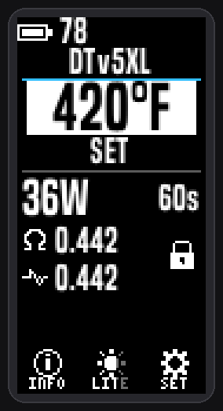
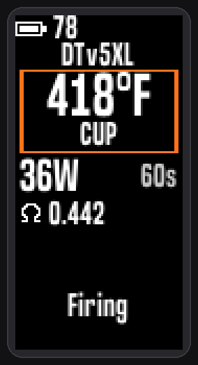
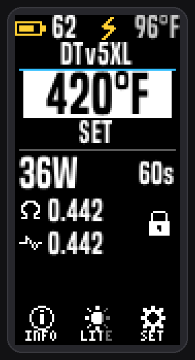
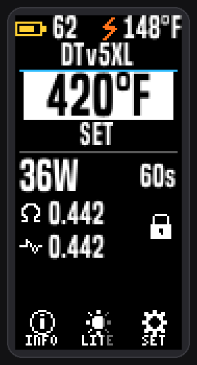
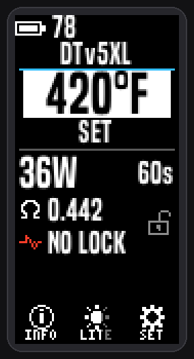
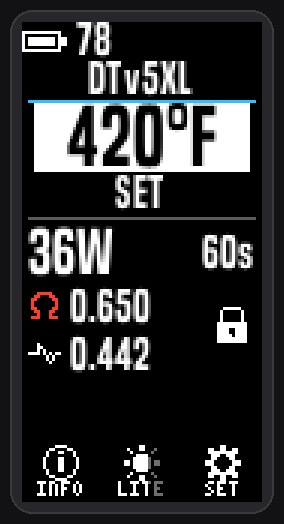
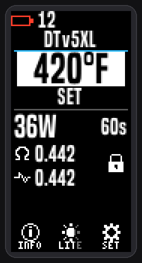
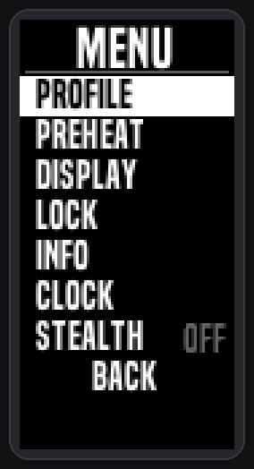
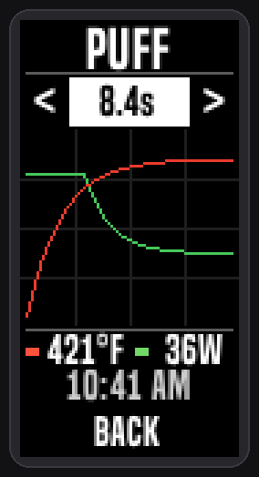
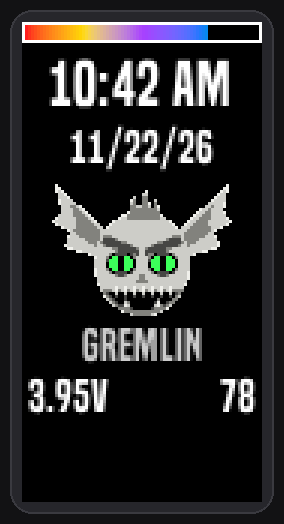

# How to use Gremlin (v2.9)

Gremlin puts everything on one screen: temperature, watts, session time, resistance and
battery, plus a chart of your last puff. Text is white so it reads in sunlight. Color is
used only as a marker.

**Works on:** tested on the Evolv DNA 100C with international firmware SP55.1. Expected
to work, not yet tested: DNA 250C and DNA 75C. Not for DNA 60C, DNA 80C, or mono or
LED-only DNA chips. [Details](../README.md#which-chips).

Not installed yet? See the [install guide](install.md).

<table>
<tr><td align="center"> Home</td><td align="center"> Firing</td><td align="center"> Charging</td></tr>
<tr><td align="center"> Board hot</td><td align="center"> Not locked</td><td align="center"> Replace cup</td></tr>
<tr><td align="center"> Low battery</td><td align="center"> Menu</td><td align="center"> Last puff</td></tr>
<tr><td align="center"> Lock screen</td></tr>
</table>

*All images on this page are preview renders made from the theme file, not photos. Your
mod's screen may look slightly different.*

## The buttons

- **Fire** (the big button): heats. On every screen except the home screen, Fire works
  as **Back**.
- **Up** and **Down**: move the highlight. It wraps around from bottom to top.
- **Select**: opens or changes the highlighted item.

**To change a value:**

1. Press **Up** or **Down** until the value is highlighted (white bar).
2. Press **Select**. The bar turns **blue**. You are now editing.
3. Press **Up** or **Down** to change the value.
4. Press **Select** again to save.

On the home screen, the highlight moves through: profile name → temperature → watts →
session time → padlock → INFO → LITE → SET, then back to the top. When the mod wakes up,
the **temperature** is already highlighted.

## The home screen, top to bottom

*Preview render: the home screen at rest. The temperature is highlighted.*

1. **Battery** icon and percentage.
2. **Profile name.** Select it to switch profiles.
3. **The big number**, and a word under it saying what it is:
   - **SET**: the temperature you have set. This is what you see at rest.
   - **CUP**: the cup's temperature, while firing.
   - **BOARD**: the chip's own temperature, on a profile with temperature control off
     (for example a cleaning profile).
4. **Watts** (left) and **session length** in seconds (right).
5. **Ω** and the **stored resistance** of your coil or cup. Temperature control works
   from this number.
6. **Pulse icon** and the **live resistance** from your last puff. It reads `0.000` until
   the first puff after the mod is switched on.
7. **Padlock:** solid means the resistance is locked; open means unlocked.
8. **Status line:** the chip's own messages, such as `Weak Battery` or `Check Atomizer`.
9. Three buttons along the bottom: **INFO** (statistics and your last puff), **LITE**
   (brightness) and **SET** (the menu).

## What the colors mean

  

*Preview renders, left to right: resistance not locked (red pulse icon, `NO LOCK`), cup due for replacement (red Ω), battery below 15% (red battery icon).*

| Color | Means | Where you see it |
|---|---|---|
| **Orange** | Active: firing, or heat | The frame around the temperature while firing. The charging bolt if the board gets hot. |
| **Red** | Warning: look at this | Battery icon below 15%. Ω icon when the cup is due for replacement. Pulse icon next to `NO LOCK`. |
| **Yellow** | Charging | Battery icon and the bolt. |

**`NO LOCK`** replaces the live resistance when temperature control is on and the
resistance is not locked. Lock it (see below).

**A red Ω** means the stored resistance is above **0.60 Ω**, or above **0.41 Ω** on
profiles 2 and 4. These limits are set for Divine Tribe V5 XL and Lightning Quest cups,
which read higher as they wear out. If your coil normally reads higher than that, you
will see the red Ω all the time. It is only a marker; it does not stop the mod firing.

## While firing

*Preview render: firing.*

- The big number shows the **cup temperature**, labeled **CUP**, inside an **orange
  frame**.
- The padlock and live resistance rows hide. The session time turns gray.
- The bottom of the screen shows the chip's status, such as `Firing`.

When you stop, the home screen returns.

## While charging

 

*Preview renders: charging (left), and charging with the board above 140°F (right).*

- The battery icon turns **yellow** and a **bolt** appears next to the percentage.
- The **board temperature** shows in the top right corner, only while charging.
- The bolt turns **orange** if the board goes above **140°F**.

## Common tasks

**Change the temperature**
1. Wake the mod. The temperature is already highlighted.
2. Press **Select**, then **Up** or **Down**, then **Select**.

**Change the watts or session length**
1. Press **Down** to highlight the watts (or once more for the session time).
2. Press **Select**, then **Up** or **Down**, then **Select**.

**Switch profile**
1. Press **Up** to highlight the profile name.
2. Press **Select**, then **Up** or **Down** to pick a profile, then **Select**.

**Lock the resistance** (do this with the cup at room temperature)
1. Highlight the **padlock** on the home screen.
2. Press **Select**. A solid padlock means locked.

**Measure the resistance again** (new cup, or the number looks wrong)
1. Make sure the cup is at room temperature and the padlock is **open**.
2. Highlight **SET** at the bottom and press **Select** to open the menu.
3. Open **PROFILE**, highlight **Re-measure**, and press **Select**.
4. Check the number, then lock it again.

**See your last puff**

*Preview render: the PUFF screen. The chart lines are illustrative, drawn to show the layout.*

1. Highlight **INFO** at the bottom and press **Select**.
2. **Last** is highlighted. Press **Select**.
3. The **PUFF** screen shows a chart of your last puff: temperature (red line) and power
   (green line) over time, with its length at the top and its peak temperature and power
   under the chart.
4. Highlight **<** or **>** and press **Select** to step through earlier puffs. Select
   the puff length to jump back to the newest one.

**Change brightness**
1. Highlight **LITE** at the bottom.
2. Press **Select**, then **Up** or **Down**, then **Select**.

**Lock or unlock the mod**
Click the fire button **five times quickly** (or the number set in **LOCK → Clicks**).

## The menu (SET)

*Preview render: the menu.*

| Menu item | What is in it |
|---|---|
| **PROFILE** | Profile, Watts, Temp, Coil (material), Session (on/off), Length, Ohm lock, Re-measure |
| **PREHEAT** | Preheat on/off, Power, Until |
| **DISPLAY** | Bright, Stealth, Stay on, Flip (turn the screen upside down), Units (°F or °C) |
| **LOCK** | Auto lock, After (how long before it locks), Clicks (how many fire clicks lock and unlock), Max puff (longest puff), Pwr bank |
| **INFO** | Battery voltage, Level, Board temperature, Puffs, Last (last puff length; select it for the chart), Avg (last puff's average power), FW (firmware), Theme version |
| **CLOCK** | Time, Date, Mode |
| **STEALTH** | Turns Evolv's stealth mode on or off in one click |
| **BACK** | Back to the home screen |

`Pwr bank` on the LOCK menu does nothing on a DNA100C. Leave it alone.

## Other screens

*Preview render: the lock screen.*

**Lock screen:** clock, date, the gremlin, battery voltage and percentage. Click Fire
five times quickly to unlock.

**NEW COIL?** appears if you change the cup while the resistance is unlocked. It shows the
new and old readings.
- **YES, NEW:** this is a new cup. The mod stores the new reading.
- **NO, OLD:** keep the old reading. This is highlighted by default, for safety.
- **LOCK?:** appears once a reading is stored. Answer YES or NO first, then lock it here.
  If the screen closes, lock it from the home screen padlock or **SET → PROFILE**.

If the resistance is locked, this screen does not appear. Unlock it, swap the cup, then
lock it again.

## Things the theme cannot do

These are limits of the chip, not the theme.

- The first puff after switching the mod on may show a blank status line.
- There is no "at temperature" signal.
- There is no live countdown of the session time.
