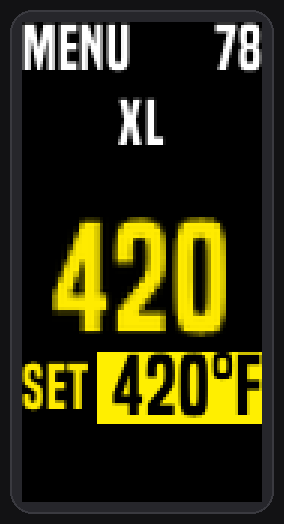
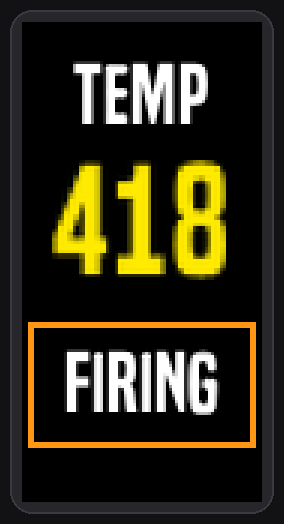
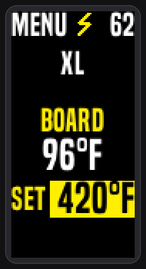
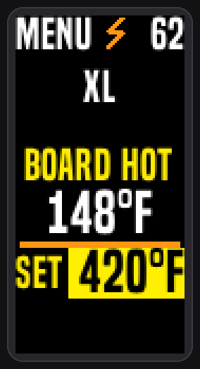
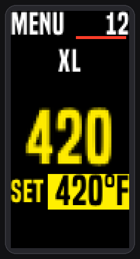
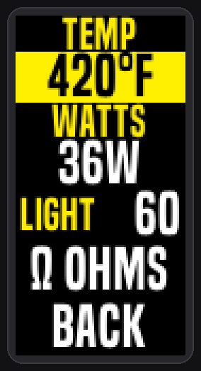
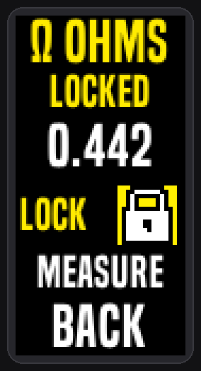
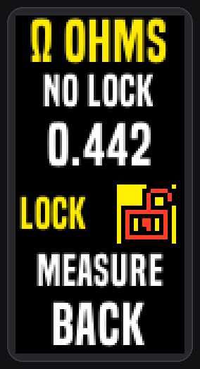
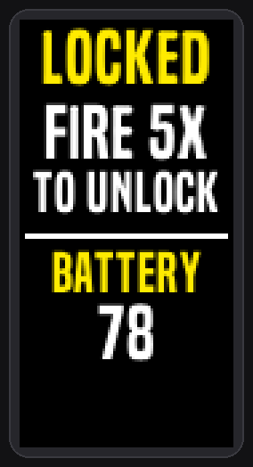

# How to use High Contrast: Large Text (v1.3)

High Contrast is the simple one, made for people who have trouble reading a mod screen.
Very large digits, white and yellow on black, and only what you need on each screen.
Everything else stays at its normal setting and is changed in EScribe.

**Works on:** tested on the Evolv DNA 100C. Expected to work, not yet tested: DNA 250C and
DNA 75C. Not for DNA 60C, DNA 80C, or mono or LED-only DNA chips. [Details](../README.md#which-chips).

Not installed yet? See the [install guide](install.md).

<table>
<tr><td align="center"> Home</td><td align="center"> Firing</td><td align="center"> Charging</td></tr>
<tr><td align="center"> Board hot</td><td align="center"> Replace cup</td><td align="center"> Low battery</td></tr>
<tr><td align="center"> Menu</td><td align="center"> Ω OHMS</td><td align="center"> Not locked</td></tr>
<tr><td align="center"> Lock screen</td></tr>
</table>

*All images on this page are preview renders made from the theme file, not photos. Your
mod's screen may look slightly different.*

## The buttons

- **Fire** (the big button): heats. In the menu, Fire works as **Back**.
- **Up** (top small button) and **Down** (bottom small button): move the highlight.
- **Select** (middle small button): opens or changes the highlighted item.

The highlighted item has a **solid yellow bar** with black text.

**To change a value:**

1. Press **Up** or **Down** until the value is highlighted.
2. Press **Select**. The bar turns **white**. You are now editing.
3. Press **Up** or **Down** to change the value.
4. Press **Select** again to save.

The home screen has three places you can press: **MENU**, the **profile name**, and the
**SET** temperature. When the mod wakes up, **SET** is already highlighted.

## The home screen, top to bottom

*Preview render: the home screen at rest. SET is highlighted.*

1. **MENU** (top left) and the **battery percentage** (top right).
2. The **profile name**, for example `XL`. Long names use two lines.
3. The **temperature** in very large yellow digits. There is no degree sign, because
   three digits at this size fill the screen. The SET line below shows °F or °C.
4. **SET** and your **set temperature**. Change it here.
5. A **status line** for the chip's messages, such as `Weak Battery`.

## Warnings

  

*Preview renders, left to right: cup due for replacement, battery below 15%, board hot while charging.*

Warnings use a **colored bar**, not colored text, so the words stay easy to read.

| You see | It means |
|---|---|
| A **red line under the battery number** | Battery below 15%. |
| A **red bar under the profile name** | The cup is due for replacement (see below). |
| **BOARD HOT**, an **orange bar** and an **orange bolt** (while charging) | The board is above 140°F. |

**The red bar under the profile name** shows when the stored resistance is above
**0.60 Ω**, or above **0.41 Ω** on profiles 2 and 4. These limits are set for Divine Tribe
V5 XL and Lightning Quest cups, which read higher as they wear out. If your coil
normally reads higher than that, you will see the bar all the time. It is only a marker;
it does not stop the mod firing. Check the number on the **Ω OHMS** screen.

## While firing

*Preview render: firing.*

The screen clears and shows only:

- **TEMP** and the current temperature in the same very large digits.
- **FIRING** inside an **orange frame**.

The status line is not shown while firing. When you stop, the home screen returns.

## While charging

*Preview render: charging.*

- A yellow **bolt** appears next to the battery number at the top.
- The large temperature is replaced by **BOARD** and the board temperature.
- If the board goes above **140°F**, it reads **BOARD HOT**, an orange bar appears and the
  bolt turns orange.

## Common tasks

**Change the temperature**
1. Wake the mod. **SET** is already highlighted.
2. Press **Select**, then **Up** or **Down**, then **Select**.

You can also change it in the menu under **TEMP**.

**Switch profile**
1. Highlight the **profile name** on the home screen.
2. Press **Select**, then **Up** or **Down** to pick a profile, then **Select**.

**Change the watts**
1. Highlight **MENU** and press **Select**.
2. Highlight **WATTS**, then **Select**, **Up** or **Down**, **Select**.

**Change brightness**
1. Open **MENU**.
2. Highlight **LIGHT**, then **Select**, **Up** or **Down**, **Select**. Higher is
   brighter.

**Lock the resistance** (do this with the cup at room temperature)
1. Open **MENU → Ω OHMS**.
2. The **LOCK** padlock is highlighted. Press **Select**. A solid padlock means locked.

**Measure the resistance again** (new cup, or the number looks wrong)
1. Make sure the cup is at room temperature.
2. Open **MENU → Ω OHMS** and unlock the padlock.
3. Press **Down** to **MEASURE**, then **Select**.
4. Check the number, then lock the padlock again.

The Ω OHMS screen opens with the padlock highlighted and MEASURE one step below it.
Press carefully: one stray Select changes the lock or measures again.

**See your last puff**
High Contrast has no puff history on the mod. Gremlin and Lantern do.

**Lock or unlock the mod**
Click the fire button **five times quickly**.

## The menu

*Preview render: the menu.*

| Item | What it does |
|---|---|
| **TEMP** | Your set temperature |
| **WATTS** | The power limit |
| **LIGHT** | Screen brightness |
| **Ω OHMS** | Opens the Ω OHMS screen: stored resistance, lock, MEASURE |
| **BACK** | Back to the home screen |

There is no profile item in the menu. Switch profiles on the home screen.

## Other screens

 

*Preview renders: Ω OHMS locked (left) and not locked (right).*

**Ω OHMS:** **LOCKED** and the stored resistance in ohms. If the resistance is not
locked, it reads **NO LOCK** and the padlock turns red. Below that are the **LOCK**
padlock, **MEASURE** and **BACK**.

*Preview render: the lock screen.*

**Lock screen:** **LOCKED**, then **FIRE 5X TO UNLOCK**, then the battery percentage. Below
15% it reads **LOW BATT** with a red line.

**NEW COIL?** appears if you change the cup while the resistance is unlocked. It shows the
new reading.
- **YES:** this is a new cup. The mod stores the new reading.
- **NO:** keep the old reading. This is highlighted by default, for safety.
- **LOCK?:** appears once a reading is stored. Answer YES or NO first, then lock it here.
  If the screen closes, lock it from **MENU → Ω OHMS**.

If the resistance is locked, this screen does not appear. Unlock it, swap the cup, then
lock it again.

## Change these in EScribe

High Contrast keeps its screens short, so these settings are changed on your computer.
Connect the mod, change the setting in EScribe, then click **Upload Settings to Device**.

- **Session length:** General tab, Session Mode, Time.
- **Profile names:** General tab, Name. Keep them short: about 8 letters fit on one line.
- **Auto-lock** and how many clicks unlock the mod.
- **Clock.**

## Tips

- Turn **LIGHT** all the way up for the clearest screen.
- Short profile names read best, for example `XL`, `QUEST`, `XL CLEAN`.
