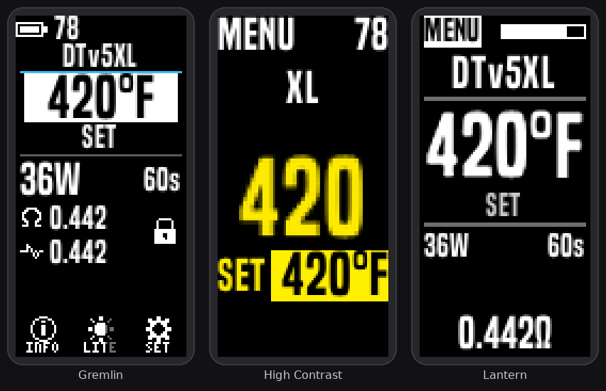

# Install guide

This guide puts one of the Gremlin themes on your mod. It takes about five minutes.

A theme changes only the screen: what it shows and how you move around it. Your
profiles, temperatures, watts and resistance stay as they are.

**Contents**

1. [What you need](#what-you-need)
2. [Step 1: Download the theme](#step-1-download-the-theme)
3. [Step 2: Connect the mod and open EScribe](#step-2-connect-the-mod-and-open-escribe)
4. [Step 3: Back up your current setup](#step-3-back-up-your-current-setup)
5. [Step 4: Load the theme](#step-4-load-the-theme)
6. [Step 5: Upload it to the mod](#step-5-upload-it-to-the-mod)
7. [Step 6: Check that it worked](#step-6-check-that-it-worked)
8. [Switching back or trying another theme](#switching-back-or-trying-another-theme)
9. [Troubleshooting](#troubleshooting)

## What you need

- A mod with an **Evolv DNA color chip**. Tested on the DNA 100C. Expected to work, not
  yet tested: DNA 250C and DNA 75C. Not for
  DNA 60C, DNA 80C, or mono or LED-only chips. See
  [Which chips](../README.md#which-chips).
- Evolv's **international firmware** on the chip. On the US firmware the theme will not
  upload. See [Troubleshooting](#no-compatible-firmware) if you are not sure.
- A computer (Windows or Mac) with **EScribe**, Evolv's free software:
  <https://www.evolvapor.com/escribe>
- A USB cable that carries data. Some USB-C cables only charge.
- Up, Select and Down buttons plus the fire button on your mod.

## Step 1: Download the theme

1. Pick a theme on the [front page](../README.md#pick-a-theme).
2. Click the file name. GitHub opens the file's page.
3. Click **Download raw file** (the download arrow near the top right of the file).
4. Save it somewhere easy to find, such as your Desktop.

The file name ends in **`.ecigtheme`**. Do not open, unzip or rename it.

Which file?

| Theme | File |
|---|---|
| Gremlin | `gremlin_current_theme.ecigtheme` (always the newest Gremlin) |
| Lantern | `lantern_v1.6_theme.ecigtheme` |
| Lantern Silver | `lantern-silver_v1.3_theme.ecigtheme` |
| Lantern Azure | `lantern-azure_v1.0_theme.ecigtheme` |
| Lantern Jade | `lantern-jade_v1.0_theme.ecigtheme` |
| High Contrast: Large Text | `gremlin_high_contrast_v1.3_theme.ecigtheme` |

The four Lantern files are the same theme in different accent colors. Pick the one you
like; you only need one.

## Step 2: Connect the mod and open EScribe

1. Connect the mod to your computer with the USB cable.
2. Open **EScribe**.
3. If it does not connect by itself, click **Connect and Download Settings**.
4. Wait until EScribe says your device is **connected on USB**.

Connect first, then load the theme. That way EScribe starts from the settings that are
on your mod now.

## Step 3: Back up your current setup

Click **File → Save** and save the file somewhere safe.

This saves everything on your mod, including its current theme. It is how you get back
to exactly where you started. See
[Switching back](#switching-back-or-trying-another-theme).

## Step 4: Load the theme

1. Click the **Theme** tab.
2. Click **Load Theme...**.
3. Choose the `.ecigtheme` file you downloaded.

Nothing has changed on the mod yet. Loading only changes EScribe's copy.

## Step 5: Upload it to the mod

Click **Upload Settings to Device**.

Keep the cable connected until EScribe finishes. When it is done, the mod's screen turns
on and shows the new theme.

## Step 6: Check that it worked

- The home screen should look like your theme's preview below. Each theme's guide shows
  every screen: [Gremlin](gremlin.md), [Lantern](lantern.md) or
  [High Contrast](high-contrast.md).

  

  *Preview renders, not photos.*
- If the screen says **LOCKED**, that is normal. Click the fire button **five times
  quickly** to unlock it.
- **Gremlin and Lantern:** open the **INFO** screen. The **Theme** row shows the version,
  for example `v2.9.01` or `v1.6.00`.
- **High Contrast** has no INFO screen. In EScribe, the Theme tab's description starts
  with `Gremlin High Contrast - Large Text v1.3`.

Now read the guide for your theme to learn the buttons.

## Switching back or trying another theme

**To try a different theme from here:** repeat Steps 1 to 6 with the other file. You do
not need to remove the old theme first.

**To go back to exactly what you had before:**

1. Connect the mod and open EScribe.
2. Click **File → Open...** and choose the backup you saved in Step 3.
3. Click **Upload Settings to Device**.

This puts back everything as it was when you saved it: the theme and all your settings.

**To go back to Evolv's standard theme:** on the **Theme** tab, click **Default Theme**,
then click **Upload Settings to Device**.

**To go back to the older Gremlin v2.5** (the one with switchable color schemes): load
[`gremlin_v2.5_theme.ecigtheme`](../files/gremlin_v2.5_theme.ecigtheme) the same way.

## Troubleshooting

### "No Compatible Firmware"

Your chip or firmware lacks a feature the theme uses. Nothing was written to the mod.
The usual cause is Evolv's **US firmware**: these themes need the **international**
firmware (SP55.1 INT or newer) for Session Mode. Also check your chip is one that works
(see [Which chips](../README.md#which-chips)).

1. Connect the mod and open EScribe.
2. Run EScribe's firmware updater and choose the **international** edition.
3. Install the theme again from [Step 4](#step-4-load-the-theme).

### The screen did not change

- Did you click **Upload Settings to Device**? Loading the theme on its own changes
  nothing on the mod.
- Check that EScribe says your device is **connected on USB**, then upload again.
- If EScribe was not connected when you loaded the theme, connect, then repeat Step 4
  and Step 5.

### The mod says LOCKED after the upload

This is normal. The mod has its own lock. Click the fire button **five times quickly**
to unlock it. Five quick clicks also lock it again.

If it keeps locking itself after a few minutes, that is the mod's auto-lock. On Gremlin
and Lantern you can turn it off in the **LOCK** menu on the mod. On High Contrast,
change it in EScribe and upload again.

### EScribe says "Failed to open file"

The file was damaged on the way, or it is not the theme file.

- Download it again with **Download raw file**. Do not copy and paste the page.
- Check that the name ends in `.ecigtheme`, not `.zip`, `.txt` or `.html`.

### EScribe does not see the mod

- Try a different USB cable. Many USB-C cables charge but do not carry data.
- Try a different USB port, and make sure the mod is switched on.
- Close and reopen EScribe, then click **Connect and Download Settings**.

### The screen looks different on another chip

These themes were tested on a **DNA 100C**. The DNA 250C and DNA 75C have the same
160×80 screen and buttons, so the themes are expected to look the same there, but that
has not been tested yet. If something is cut off at an edge or looks wrong on your chip,
please [open an issue](https://github.com/Gerglem/gremlin-dna/issues). Tell us your chip,
your firmware (international or US), and add a photo of the screen.

### Still stuck?

[Open an issue](https://github.com/Gerglem/gremlin-dna/issues). Your chip, firmware
edition and the exact message you see are most of the answer.
