# How to use Lantern (v1.6)

Lantern is the calm one. The home screen answers three questions at a glance: what will
the mod do, is anything wrong, and what is happening during a puff. One big number, and
nothing moves around while you fire.

**Works on:** tested on the Evolv DNA 100C with international firmware SP55.1. Expected
to work, not yet tested: DNA 250C and DNA 75C. Not for DNA 60C, DNA 80C, or mono or
LED-only DNA chips. [Details](../README.md#which-chips).

Not installed yet? See the [install guide](install.md).

<table>
<tr><td align="center">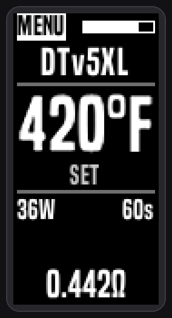 Home</td><td align="center">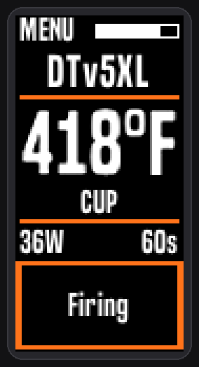 Firing</td><td align="center">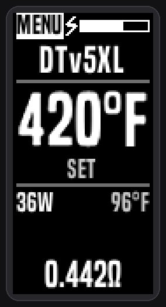 Charging</td></tr>
<tr><td align="center">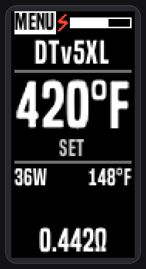 Board hot</td><td align="center">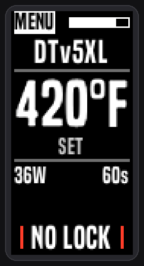 Not locked</td><td align="center">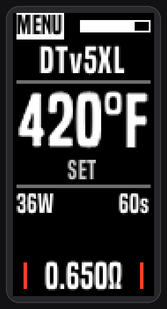 Replace cup</td></tr>
<tr><td align="center">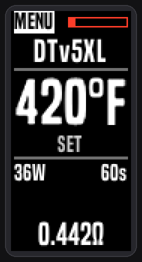 Low battery</td><td align="center">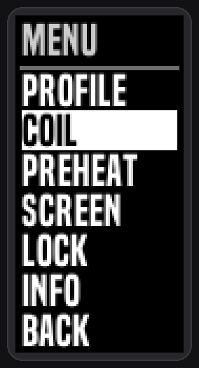 Menu</td><td align="center">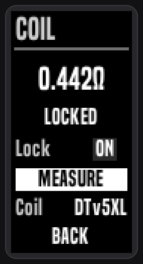 COIL</td></tr>
<tr><td align="center">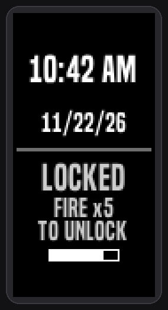 Lock screen</td><td align="center">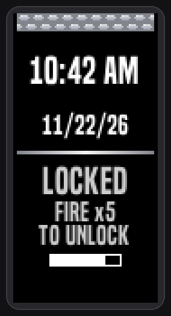 Silver lock screen</td></tr>
</table>

*All images on this page are preview renders made from the theme file, not photos. Your
mod's screen may look slightly different.*

## Four accent colors

Lantern comes as four files. They are the same theme. Only the selection bar, the thin
lines and the charging bolt change color. Pick the one you like.

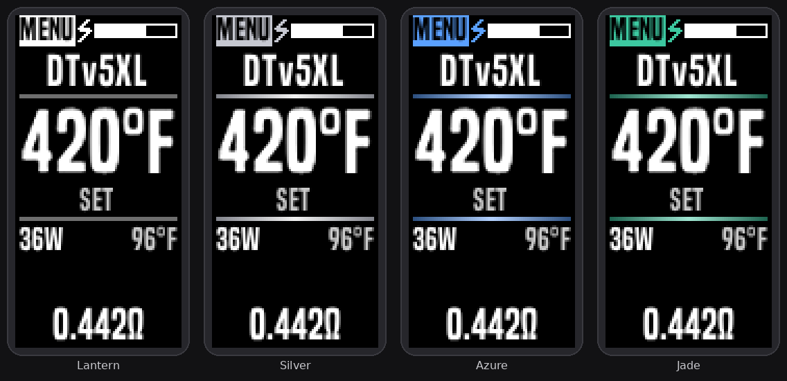

*Preview (computer render, not a photo). Left to right: Lantern (white), Silver, Azure
(blue), Jade (green), shown while charging.*

| Accent | File |
|---|---|
| Lantern (white) | [`lantern_v1.6_theme.ecigtheme`](../files/lantern_v1.6_theme.ecigtheme) |
| Silver | [`lantern-silver_v1.3_theme.ecigtheme`](../files/lantern-silver_v1.3_theme.ecigtheme) (also adds a silver scale pattern to the lock screen) |
| Azure (blue) | [`lantern-azure_v1.0_theme.ecigtheme`](../files/lantern-azure_v1.0_theme.ecigtheme) |
| Jade (green) | [`lantern-jade_v1.0_theme.ecigtheme`](../files/lantern-jade_v1.0_theme.ecigtheme) |

To change accent, install a different file. See the [install guide](install.md).

## The buttons

- **Fire** (the big button): heats. On every screen except the home screen, Fire works
  as **Back**.
- **Up** and **Down**: move the highlight. It wraps around from bottom to top.
- **Select**: opens or changes the highlighted item.

**To change a value:**

1. Press **Up** or **Down** until the value is highlighted.
2. Press **Select**. The bar turns **dark blue**. You are now editing.
3. Press **Up** or **Down** to change the value.
4. Press **Select** again to save.

The home screen has only **three** places you can press: **MENU** → **profile name** →
**temperature**. When the mod wakes up, **MENU** is highlighted. That way a stray press
opens a menu instead of changing a number.

## The home screen, top to bottom

*Preview render: the home screen at rest. MENU is highlighted.*

1. **MENU** (top left) and the **battery gauge** (top right).
2. **Profile name.**
3. A thin line.
4. **The big number**, and a word under it saying what it is:
   - **SET**: the temperature you have set. This is what you see at rest.
   - **CUP**: the cup's temperature, while firing.
   - **BOARD**: the chip's own temperature, on profiles 3 and 4 (the cleaning profiles
     in the Divine Tribe setup).
5. A thin line.
6. **Watts** (left) and **session length** (right). You can read them here; change them
   in **MENU → PROFILE**.
7. A space for the chip's messages, such as `Weak Battery` or `Check Atomizer`. It stays
   empty most of the time.
8. The **stored resistance** of your coil or cup, for example `0.442Ω`. Temperature
   control works from this number.

## What the colors mean

  

*Preview renders, left to right: `NO LOCK` between red bars, a cup due for replacement between red bars, battery below 15% (red gauge).*

| Color | Means | Where you see it |
|---|---|---|
| **Orange** | The coil is live | The two thin lines and a frame at the bottom light up while firing. |
| **Red** | Warning: look at this | Two red bars around the resistance (see below). The battery gauge below 15%. The charging bolt if the board gets hot. |
| **Accent** (white, silver, blue or green) | Nothing special | The selection bar, the thin lines at rest, the charging bolt. |

**Two red bars around the bottom line** mean one of two things:

- **`NO LOCK`:** the resistance is not locked. This shows on profiles 1 and 2. Lock it
  (see below).
- **A number between red bars:** the stored resistance is above **0.60 Ω**, or above
  **0.41 Ω** on profiles 2 and 4. These limits are set for Divine Tribe V5 XL and
  Lightning Quest cups, which read higher as they wear out. If your coil normally reads
  higher than that, you will see the bars all the time. It is only a marker; it does not
  stop the mod firing.

## While firing

*Preview render: firing.*

- The two thin lines turn **orange**, and an **orange frame** appears around the chip's
  message at the bottom (such as `Firing`).
- The big number shows the **cup temperature**, labeled **CUP**.
- Nothing moves. The numbers stay where they were; the frame covers the resistance line
  until you stop.

When you stop, the lines go back to normal.

## While charging

 

*Preview renders: charging (left), and charging with the board above 140°F (right).*

- A **bolt** appears next to **MENU**.
- The **board temperature** takes the place of the session length until you unplug.
- The bolt turns **red** if the board goes above **140°F**.

## Common tasks

**Change the temperature**
1. Wake the mod. **MENU** is highlighted.
2. Press **Up** once. The temperature is highlighted.
3. Press **Select**, then **Up** or **Down**, then **Select**.

**Switch profile**
1. Press **Down** once. The profile name is highlighted.
2. Press **Select**, then **Up** or **Down** to pick a profile, then **Select**.

**Change the watts or session length**
1. With **MENU** highlighted, press **Select**.
2. Open **PROFILE**.
3. Highlight **Watts** or **Length**, then **Select**, **Up** or **Down**, **Select**.

**Lock the resistance** (do this with the cup at room temperature)
1. Open **MENU → COIL**.
2. Highlight **Lock** and press **Select**. It reads **ON** when locked.

**Measure the resistance again** (new cup, or the number looks wrong)
1. Make sure the cup is at room temperature.
2. Open **MENU → COIL** and turn **Lock** off.
3. Highlight **MEASURE** and press **Select**.
4. Check the number, then turn **Lock** back on.

**See your last puff**
Open **MENU → INFO**. **Last** is the length of your last puff in seconds, and **Avg**
is its average power in watts. (Lantern has no puff chart. Gremlin does.)

**Change brightness**
Open **MENU → SCREEN** and change **Bright**.

**Set the clock**
Open **MENU → SCREEN → Clock**.

**Lock or unlock the mod**
Click the fire button **five times quickly** (or the number set in **LOCK → Clicks**).

## The menu

 

*Preview renders: the menu (left) and the COIL screen (right).*

| Menu item | What is in it |
|---|---|
| **PROFILE** | Profile, Watts, Temp, Session (on/off), Length |
| **COIL** | Stored resistance, `LOCKED` or `NO LOCK`, Lock, MEASURE, Coil (material) |
| **PREHEAT** | Preheat on/off, Power, Until |
| **SCREEN** | Bright, Stealth, Stay on, Flip (turn the screen upside down), Units (°F or °C), Clock |
| **LOCK** | Auto (auto-lock), After (how long before it locks), Clicks (how many fire clicks lock and unlock), Cutoff (longest puff) |
| **INFO** | Battery voltage, Level, Board temperature, Puffs, Last (last puff length), Avg (last puff's average power), FW (firmware), Theme version |
| **BACK** | Back to the home screen |

## Other screens

 

*Preview renders: the lock screen (left) and Lantern Silver's lock screen with its scale pattern (right).*

**Lock screen:** the clock, the date, `LOCKED` / `FIRE x5` / `TO UNLOCK`, and the battery
gauge. Click Fire five times quickly to unlock.

**NEW COIL?** appears if you change the cup while the resistance is unlocked. It shows the
new reading.
- **YES:** this is a new cup. The mod stores the new reading.
- **NO:** keep the old reading. This is highlighted by default, for safety.
- **Lock:** appears once a reading is stored. Answer YES or NO first, then lock it here.
  If the screen closes, lock it from **MENU → COIL**.

If the resistance is locked, this screen does not appear. Unlock it, swap the cup, then
lock it again.
